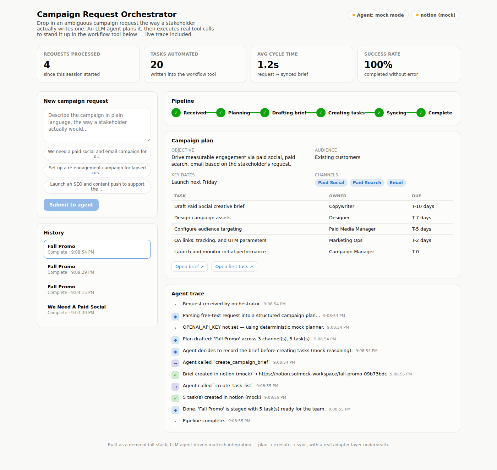

# Campaign Request Orchestrator
### From an ambiguous brief to an executable campaign plan.

A full-stack marketing operations prototype that turns a plain-language request into a structured plan, then executes workflow actions through a tool-calling agent.



## The business problem
Campaign requests arrive without a consistent structure. Turning them into briefs, tasks, and handoffs takes repetitive coordination. This project makes that translation visible and repeatable.

## What I built
- **Plan:** structured LLM output produces a typed campaign plan.
- **Execute:** an OpenAI tool-calling loop creates briefs and task lists.
- **Integrate:** a workflow adapter separates orchestration from the Notion implementation.
- **Observe:** a React dashboard shows pipeline stages, request history, plans, and execution traces.

**Stack:** Python · FastAPI · Pydantic · OpenAI API · Notion API · React · TypeScript · Vite

## Explore
- [Implementation and architecture](gradial-fde-project-upload/README.md)
- [Discovery and business process decisions](gradial-fde-project-upload/docs/DISCOVERY_DOC.md)
- [Agent execution loop](gradial-fde-project-upload/backend/app/agent.py)
- [Integration interface](gradial-fde-project-upload/backend/app/integrations/base.py)

## Run locally
From the repository root, use two terminals.

**Backend**
```bash
cd gradial-fde-project-upload/backend
python3 -m venv .venv
source .venv/bin/activate
pip install -r requirements.txt
uvicorn app.main:app --reload --port 8000
```

**Frontend**
```bash
cd gradial-fde-project-upload/frontend
npm install
npm run dev
```

The default frontend API address is `http://localhost:8000`. Set `VITE_API_BASE` for another backend. Mock mode requires no API keys. For live mode, configure `OPENAI_API_KEY`, `NOTION_API_KEY`, `NOTION_PARENT_PAGE_ID`, and `NOTION_TASKS_DATABASE_ID` on the backend. Secrets belong in local environment configuration, never in committed files.

## Scope
Portfolio prototype. Mock planning is heuristic; live mode uses an LLM. Persistence is a JSON file, and the API has no authentication. These are explicit boundaries for a demonstration, not production-readiness claims.

---
Built by [Vishwa Mehta](https://www.linkedin.com/in/vishwa10/) · Forward Deployed Engineer
