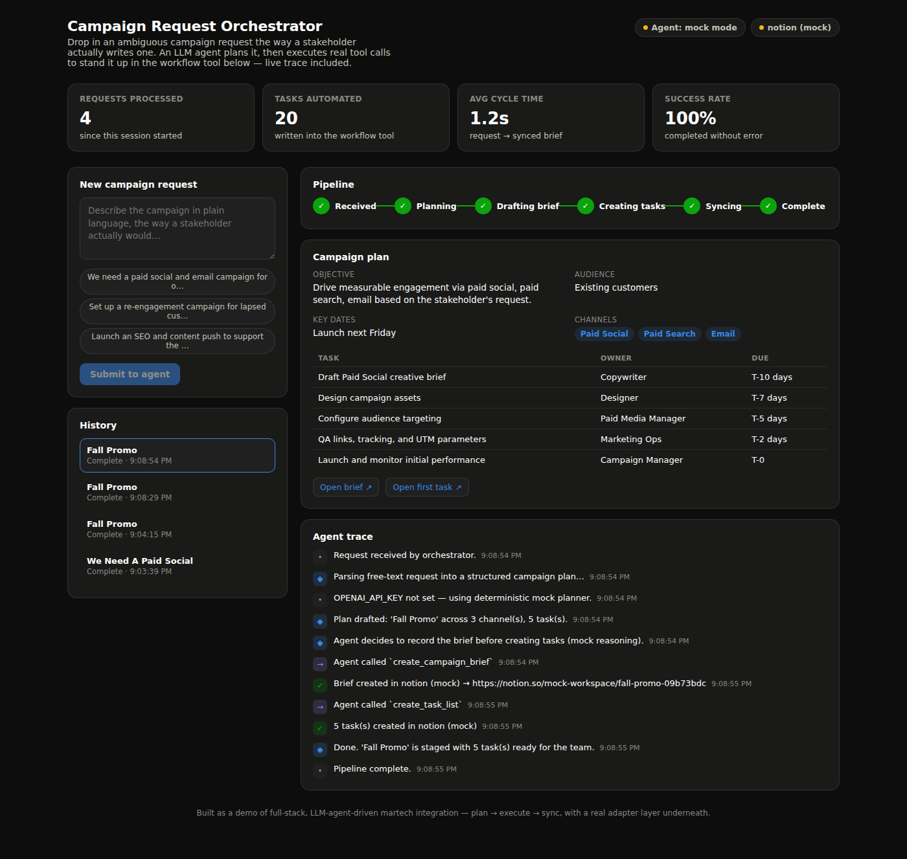
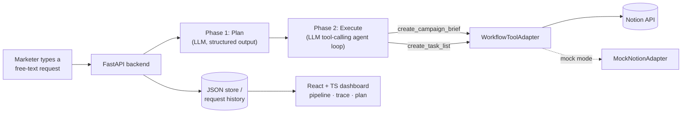

# Campaign Request Orchestrator

A small, working demo of the pattern behind AI-native marketing-ops platforms:
turn one ambiguous, plain-language request from a marketer into a structured
plan, then have an LLM agent actually execute that plan against a real
workflow tool (Notion) — with a live dashboard showing every step.

> **Try it:** type something like *"We need a paid social and email campaign
> for our fall promo, targeting existing customers, launch by next Friday"*
> into the request box and watch the pipeline run.


<details>
<summary>Dark mode</summary>



</details>

## Why this exists

This was built to demonstrate the core loop of a Forward Deployed Engineer
role on an AI martech platform: **discovery → prototype → implementation.**
See [`docs/DISCOVERY_DOC.md`](docs/DISCOVERY_DOC.md) for the write-up of the
ambiguous business process this system targets and the design decisions
behind it.

The build runs end-to-end with **zero API keys** (mock mode, see below), so
you can clone it and see the whole pipeline work immediately. Drop in a real
OpenAI key and a real Notion integration and it goes live — same code path,
real systems.

## Architecture



**The adapter pattern is the load-bearing design decision here.** The agent
loop (`backend/app/agent.py`) never talks to Notion directly — it talks to
`WorkflowToolAdapter`, an abstract interface (`backend/app/integrations/base.py`)
with `create_brief()` / `create_tasks()` / `health_check()`. Notion is one
implementation; the next customer's HubSpot, Airtable, or Asana instance would
be another, with zero changes to the planning or orchestration code. This
mirrors the "reusable tools, adapters, and configuration layers for scalable
onboarding" problem that comes up in enterprise martech integration work.

The agent itself is a genuine two-phase LLM pipeline, not a single prompt:

1. **Plan** — one structured-output call (`response_format: json_schema`)
   turns the free-text request into a typed `CampaignPlan` (audience,
   channels, timeline, tasks).
2. **Execute** — a real OpenAI tool-calling loop. The model decides when to
   call `create_campaign_brief` and `create_task_list`; our code executes
   those calls against the adapter and feeds real results back to the model
   until it's done. Every tool call and result is logged to the trace you see
   in the dashboard.

## Project layout

```
backend/
  app/
    main.py                 FastAPI routes
    agent.py                 planning + tool-calling execution loop
    models.py                 Pydantic schema (CampaignPlan, trace, etc.)
    store.py                   tiny JSON-file persistence
    integrations/
      base.py                    WorkflowToolAdapter interface
      notion_adapter.py     real Notion REST implementation
      mock_adapter.py        zero-key fallback + adapter factory
frontend/
  src/
    App.tsx                    layout + polling
    components/           RequestForm, PipelineStages, TraceLog, PlanCard, ...
    lib/                          typed API client
docs/
  DISCOVERY_DOC.md    the business-process writeup
```

## Running it locally

### 1. Backend

```bash
cd backend
python3 -m venv .venv && source .venv/bin/activate
pip install -r requirements.txt
cp .env.example .env       # leave keys blank to run in mock mode
uvicorn app.main:app --reload --port 8000
```

### 2. Frontend

```bash
cd frontend
npm install
cp .env.example .env       # points at the backend above
npm run dev
```

Open the printed localhost URL. In mock mode everything works immediately —
no accounts needed.

### 3. Going live (optional)

To see it write into a real Notion workspace and reason with a real model:

1. **OpenAI** — get a key at platform.openai.com/api-keys, put it in
   `backend/.env` as `OPENAI_API_KEY`.
2. **Notion** — create an integration at notion.so/my-integrations, create a
   page ("Campaign Briefs") and a database ("Campaign Tasks") with `Owner` and
   `Due` text properties, share both with your integration, and put the
   integration secret + both IDs in `backend/.env`.
3. Restart the backend. The status pill in the top-right of the dashboard
   flips from "mock mode" to the live model name once a key is detected.

Full instructions with exact field names are in `backend/.env.example`.

## What's intentionally simple

This is a portfolio-scoped build, not a production system — a few corners
were cut on purpose and are worth naming rather than hiding:

- **Persistence** is a JSON file, not Postgres — fine for a single-user demo,
  the wrong choice for concurrent writers.
- **Auth** doesn't exist — every request hits the same unauthenticated API.
- **One workflow-tool adapter** (Notion) ships; the interface is designed to
  make a second one a same-day addition, but only one is implemented here.
- **The mock planner** is a heuristic, not an LLM — it exists so the whole
  product is demoable with no API costs and no keys, not as a claim that it
  reasons like the real thing.
